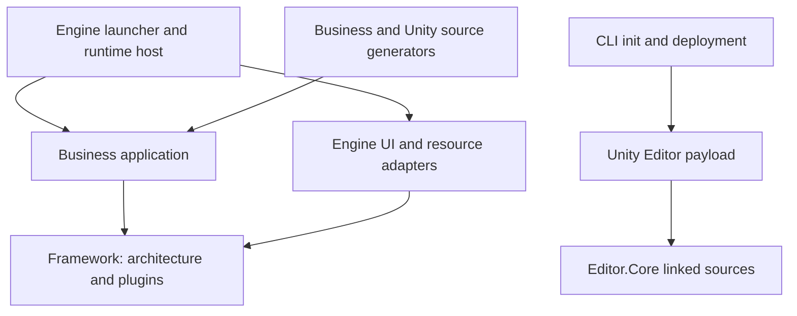

# Project and source map

Paths in this table are relative to the repository root. The solution is `Framework/ObFramework.sln`; `Framework` is the source folder of the `ObFramework` runtime project.

| Project | Responsibility | Guide / declarations |
| --- | --- | --- |
| Framework | Engine-neutral architecture, plugins, integrated modules and utilities | [Guide](Framework/README.md), [API](Framework/api/README.md) |
| ObFramework.Adapter.Unity | Unity host, frame bridge, native UI, binding attributes, Editor payload | [Guide](ObFramework.Adapter.Unity/README.md), [API](ObFramework.Adapter.Unity/api/README.md) |
| ObFramework.Adapter.Godot | Scene-tree runtime host, Control windows, packed-scene resources | [Guide](ObFramework.Adapter.Godot/README.md), [API](ObFramework.Adapter.Godot/api/README.md) |
| ObFramework.Adapter.UnrealSharp | Unreal host, UMG windows and engine ownership | [Guide](ObFramework.Adapter.UnrealSharp/README.md), [API](ObFramework.Adapter.UnrealSharp/api/README.md) |
| ObFramework.Cli | `ob` dotnet tool: init, configuration generation, deployment and diagnostics | [Guide](ObFramework.Cli/README.md), [API](ObFramework.Cli/api/README.md) |
| ObFramework.Editor.Core | Engine-neutral UI source generation, binding tables, setup snapshots | [Guide](ObFramework.Editor.Core/README.md), [API](ObFramework.Editor.Core/api/README.md) |
| ObFramework.Generator | Roslyn observable, relay-command and save generators | [Guide](ObFramework.Generator/README.md), [API](ObFramework.Generator/api/README.md) |
| ObFramework.Generator.Unity | Roslyn View construction and native-control bindings | [Guide](ObFramework.Generator.Unity/README.md), [API](ObFramework.Generator.Unity/api/README.md) |

`ObFramework.Editor.Core` links physical files in `ObFramework.Adapter.Unity/EditorDeploy/Core`. Those declarations occur in both source inventories intentionally: one deployed Editor payload and one pure .NET compilation boundary. `Framework/ThirdParty/VCotainer` contains the vendored VContainer implementation; treat it as a separate maintenance concern from framework APIs.

Startup builds a plugin dependency graph, starts it, creates the Architecture, binds an optional frame driver, then enters business code. Shutdown unbinds the driver, requests cancellation, drains application work, releases the driver's owned runtime objects, stops business code, deinitializes the Architecture, stops plugins in reverse dependency order, then releases application-owned adapters. See [PluginApplication source](https://github.com/OBSERVATER/ObFramework/blob/5471678c694280782ef353e887accd18a03296e8/Framework/Core/Plugins/PluginApplication.cs) for the exact order and aggregated errors.

Engine projects carry local engine assembly references. Build the runtime or the relevant adapter project with its required SDK and engine assemblies. Verify application behavior in the selected engine and target platform.
